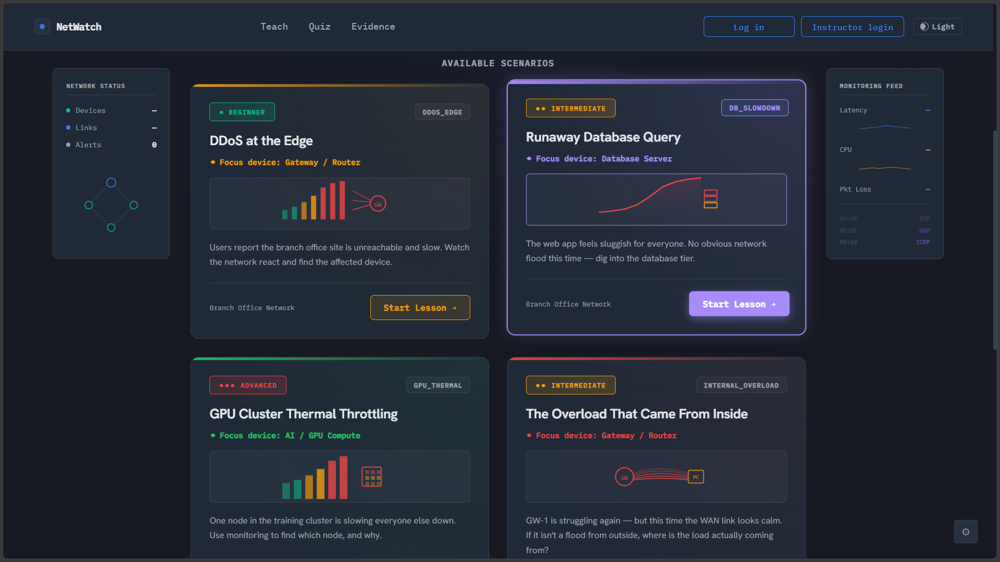

<div align="center">
  

  # NetWatch

  **Learn to diagnose network failures, not just read about them.**

  
  
  

  
</div>

NetWatch is a browser-based training platform for network monitoring and incident diagnosis. Students work through simulated incidents using the same evidence a NOC engineer would see (topology, metrics, alerts, packet captures and logs) and have to name the root cause. It teaches how to read signals and reason from evidence, not how to configure or build networks, so no infrastructure background is needed.

## How it works

Every scenario gives you five views of the same incident:

| Evidence | What it shows |
|---|---|
| **Topology** | Network map with live link and device health |
| **Metrics** | Charts for latency, packet loss, CPU, jitter and throughput |
| **Alerts** | Timestamped events with severity levels |
| **Packets** | Simulated captures with anomalies highlighted |
| **Logs** | Device-level events for reconstructing what happened |

There are two modes:

**Teach mode** needs no login. Every device, metric, alert and packet has an explanation, and short ungraded self-check questions confirm you understood. Start here.

**Quiz mode** requires a student account. Explanations are hidden. You investigate on your own and submit a root-cause diagnosis from multiple-choice options.



Quiz rules:
- Each student gets **3 attempts per scenario**.
- Score = `100 − (10 × hints used) − (20 × wrong submissions)`, clamped to 0–100. An incorrect diagnosis scores 0.
- The score is computed on the server and results are stored server-side.
- A leaderboard ranks students by best score or fastest time. Only scores of 80 or above qualify, and only display names are shown, never student IDs.

Instructors can add students in bulk, view all results, and reset attempt limits (with a backup of the old counters kept for audit).

## Quick start

**Requirements:** Node.js **22.5 or newer** (NetWatch uses the built-in `node:sqlite` module, so there is no native database driver to install) and a modern browser.

```bash
git clone https://github.com/iqbalthehitchhiker/NetWatch.git
cd NetWatch
npm install
```

Create a `.env` file in the project root:

```env
JWT_SECRET=change-me-to-a-long-random-string   # required, the server refuses to start without it
PORT=3000                                      # optional, default 3000
DB_PATH=./netwatch.db                          # optional, default is netwatch.db in the project root
```

Create an instructor account and a student account. The database file is created automatically on first run:

```bash
npm run seed:instructor -- --username admin --name "Prof. Smith" --password <password>
npm run seed:student -- --npm 12345 --name "Jane Doe" --password <password>
```

Start the app:

```bash
npm start        # production
npm run dev      # auto-restart on file changes
```

Open `http://localhost:3000`. Teach mode works immediately; log in with the student account for Quiz mode, or use the instructor login to manage students.

## Project structure

```
NetWatch/
├── backend/
│   ├── app.js              # Express app: middleware, routes, static files
│   ├── server.js           # Starts the app on PORT
│   ├── db.js               # SQLite schema, migrations and queries
│   ├── constants.js        # Attempt limit, JWT expiry, bcrypt rounds
│   ├── rateLimit.js        # Login rate limiting
│   ├── seed.js             # CLI for creating student/instructor accounts
│   ├── middleware/auth.js  # Bearer-token checks (student / instructor)
│   └── routes/             # auth, attempts, results, leaderboard, admin
├── src/                    # Frontend (plain ES modules, no build step)
│   ├── app.js              # Main orchestrator
│   ├── engine.js           # Network simulation engine
│   ├── lessons.js          # Scenarios, incident scripts and teach lessons
│   ├── scoring.js          # Client-side score display
│   ├── self-check.js       # Teach-mode self-check questions
│   ├── explain-content*.js # Teach-mode explanations
│   ├── api.js, auth.js     # API client and session handling
│   └── renderers/          # Topology, charts, alerts, packets, logs, overview
├── public/                 # Styles and fonts
├── tests/                  # Vitest suite
├── docs/                   # Requirements, design and task notes
└── index.html              # Single-page app shell
```

## Authentication

- Login returns a **JWT** (8-hour expiry) in the response body. The frontend stores it in `sessionStorage` and sends it as `Authorization: Bearer <token>`.
- Passwords are hashed with **bcrypt** (12 rounds).
- Failed logins are **rate limited** per account and IP.
- Two roles: `student` (identified by NPM) and `instructor` (identified by username).
- Logout is client-side: the token is discarded, but it is not revoked server-side and stays valid until it expires.

## API

All endpoints are under `/api`. "Student" and "Instructor" mean a valid Bearer token with that role.

| Method | Endpoint | Access | Purpose |
|---|---|---|---|
| POST | `/auth/login` | Public | Student: `{ npm, password }`. Instructor: `{ username, password, role: "instructor" }`. Returns `{ token, name, role }` (plus `displayName` for students) |
| PATCH | `/auth/display-name` | Student | Set leaderboard name (2–24 characters) |
| POST | `/attempts` | Student | Start an attempt: `{ lessonId }`. Returns `{ allowed, attemptsUsed, attemptLimit, attemptId }` |
| GET | `/attempts?studentId&lessonId` | Student | Remaining attempts (read-only, own data only) |
| POST | `/results` | Student | Submit a diagnosis: `{ lessonId, outcome, hints_used, wrong_answers, attemptId }`. Returns `{ id, recordedAt, score, bestScore }` |
| GET | `/results?studentId&lessonId` | Student | Own results for one lesson |
| GET | `/results/all` | Instructor | All results |
| GET | `/leaderboard` | Public | Query: `lesson` (id or `overall`), `sort` (`score` or `speed`), `minScore` (default 80), `limit`, `offset` |
| GET | `/admin/students` | Instructor | List students |
| POST | `/admin/students/bulk` | Instructor | Add students in bulk |
| DELETE | `/admin/students` | Instructor | Remove students |
| POST | `/admin/reset` | Instructor | Reset one student's attempts |
| POST | `/admin/reset/bulk` | Instructor | Reset attempts for many students |

Request details for the admin endpoints are in `backend/routes/admin.js`.

## Database

SQLite, created and migrated automatically by `backend/db.js`:

- `Student_Accounts`: NPM, name, display name, password hash
- `Instructor_Accounts`: username, name, password hash
- `Attempt_Counters`: attempts used per (student, lesson)
- `Attempts`: start time of each attempt, used to compute duration
- `Result_Records`: outcome, score, hints, wrong answers and duration per submission
- `Attempt_Counter_Backups`: audit trail when an instructor resets attempts

## Development

```bash
npm test                   # Vitest suite
npm run test -- --coverage # with coverage
npm run test:integration   # results integration test
```

To add a scenario, add an entry to `src/lessons.js` following an existing one (for example `ddos_edge`). Each scenario defines its topology, scripted incident events and diagnosis options, with the right answer marked `correct: true`.

Theme colors are CSS custom properties at the top of `public/styles.css`.

## Known limitations

NetWatch is an educational tool and does not yet defend against a determined student.

1. **The answer key ships to the browser.** The correct option is marked `correct: true` in `src/lessons.js`, which anyone can read in DevTools.
2. **The client decides correctness.** The server computes the score but trusts the `outcome` the client sends. Together with #1, a student can claim a correct diagnosis for full credit. The fix is to validate diagnoses server-side.
3. **Duration includes idle time.** It runs from attempt start to result submission, so speed rankings can be skewed by walking away.
4. **Abandoned attempts still count.** The attempt counter increments when a simulation loads, which prevents scouting scenarios for free. Closing the tab mid-attempt uses up a slot.
5. **No pause or resume.** Refreshing mid-simulation abandons the attempt.
6. **Sessions are per tab.** Closing the tab logs you out, and tokens cannot be revoked before they expire.
7. **`node:sqlite` is still marked experimental in Node.** It works on current Node releases, but the API could change.

## Roadmap

- Server-side answer validation (remove `correct` from the client)
- Idle-time detection for fairer timing
- Pause and resume for long scenarios
- Per-lesson attempt limits

## Contributing

Fork the repo, create a feature branch, run `npm test`, and open a pull request.

## License

MIT. See [LICENSE](LICENSE).

## Author

**Iqbal** · iqbalinggil@gmail.com
