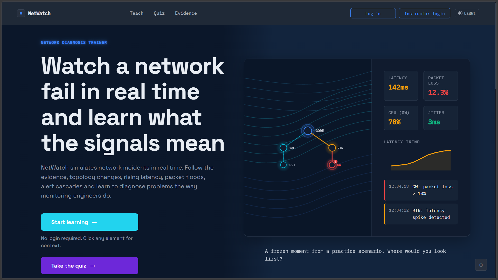

<div align="center">
  
  
  # NetWatch — Network Monitoring Trainer

  
  

  **NetWatch** is an interactive network diagnosis training platform that teaches students and professionals how to monitor, analyze, and diagnose network incidents using real-world signals — without requiring prior networking infrastructure knowledge.

  
  *NetWatch landing page — Learn to diagnose network failures*
</div>

## 🎯 What Makes NetWatch Different

NetWatch focuses on **network monitoring and diagnosis**, not configuration or infrastructure building. Students learn to:
- Read and interpret telemetry data (latency, packet loss, CPU, throughput)
- Analyze network topology and device health
- Investigate packet captures and logs
- Connect multiple evidence sources to identify root causes
- Diagnose real-world network incidents through simulation

## 🚀 Features

### Two Learning Modes

#### 🎓 Teach Mode (Open Access)
- Explanations available for every device, metric, alert, and packet
- Self-check questions to confirm comprehension (ungraded)
- No login required
- Perfect for learning how to read network signals

#### 📝 Quiz Mode (Authenticated)


*Quiz Mode — Diagnose network incidents without guidance*

- Explanations hidden — investigate evidence independently
- Submit root-cause diagnosis from multiple-choice options
- Attempt-limited per scenario
- Results recorded server-side
- Requires student login

### Five Evidence Sources

Every network incident provides five complementary views:

1. **Topology** — Visual network map with real-time link health indicators
2. **Metrics** — Live telemetry charts (latency, packet loss, CPU, jitter, throughput)
3. **Alerts** — Timestamped event timeline with severity levels
4. **Packets** — Simulated packet captures with anomaly highlighting
5. **Logs** — Device-level timestamped events for incident reconstruction

### Interactive Dashboard

- Real-time network simulation engine
- Linux-inspired terminal aesthetic
- Light/dark theme support
- Responsive design
- Accessibility-compliant interface

## 📋 Prerequisites

- **Node.js** 18+ and **npm**
- **SQLite3** (bundled with Node.js)
- Modern web browser (Chrome, Firefox, Edge, Safari)

## 🔧 Installation

```powershell
# Clone the repository
git clone https://github.com/yourusername/netwatch.git
cd netwatch

# Install dependencies
npm install

# Initialize the database with sample data
npm run seed:student
```

## 🏃 Running the Application

### Development Mode (with auto-reload)
```powershell
npm run dev
```

### Production Mode
```powershell
npm start
```

The application will start on `http://localhost:3000`

## 📁 Project Structure

```
NetWatch/
├── backend/              # Express.js server
│   ├── routes/          # API endpoints (auth, admin, attempts, results)
│   ├── middleware/      # JWT authentication
│   ├── db.js           # SQLite database interface
│   ├── server.js       # Express app entry point
│   └── seed.js         # Database seeding script
├── src/                 # Frontend modules
│   ├── renderers/      # UI rendering components
│   ├── app.js          # Main application orchestrator
│   ├── auth.js         # Client-side authentication
│   ├── engine.js       # Network simulation engine
│   ├── lessons.js      # Lesson definitions and incident scripts
│   ├── scoring.js      # Quiz scoring logic
│   └── utils.js        # Shared utilities
├── public/
│   └── styles.css      # Application styles
├── tests/              # Vitest test suite
└── index.html          # Single-page application shell
```

## 🧪 Testing

```powershell
# Run all tests
npm test

# Run tests with coverage
npm run test -- --coverage
```

Test coverage includes:
- Backend API endpoints
- Simulation engine
- Scoring logic
- Authentication flows
- UI component rendering

## 🎓 Usage

### For Students

1. **Explore Teach Mode First** — Visit the landing page and click "Learn how it works"
2. **Select a Scenario** — Choose from available network incidents
3. **Watch the Incident Unfold** — Observe metrics, alerts, and device health in real-time
4. **Investigate Evidence** — Click on devices, alerts, and metrics for explanations
5. **Practice in Quiz Mode** — Log in and test your diagnostic skills

### For Instructors

1. **Access Admin Panel** — Click "Admin" in the footer
2. **Manage Students** — Add students, view results, reset attempts
3. **Monitor Progress** — Track student performance across scenarios
4. **Seed Instructor Account**:
   ```powershell
   npm run seed:instructor
   ```
   Default credentials: `instructor` / `instructor123`

## 🗃️ Database Schema

The application uses SQLite with the following core tables:

- **Student_Accounts** — Student authentication (npm, name, password_hash)
- **Instructor_Accounts** — Instructor authentication (username, name, password_hash)
- **Attempt_Counters** — 3-attempt limit enforcement per (npm, lesson_id)
- **Attempts** — Start timestamp for each quiz attempt
- **Result_Records** — Diagnosis submissions with score, hints, wrong answers, duration
- **Attempt_Counter_Backups** — Audit trail when instructors reset attempt limits

## 🔐 Authentication

- **JWT-based** authentication with HttpOnly cookies
- **Bcrypt** password hashing
- Role-based access (student/instructor)
- Session persistence across browser restarts

## 🎨 Customization

### Adding New Scenarios

Edit `src/lessons.js` to define new network topologies and incident scripts:

```javascript
export const LESSONS = [
  {
    id: 'my-scenario',
    title: 'My Custom Scenario',
    topology: 'branch_office',
    difficulty: 'medium',
    skillCards: [...],
    incident: { /* scripted events */ },
    diagnoses: [...],
    correctIndex: 0
  }
];
```

### Styling

All styles are in `public/styles.css` with CSS custom properties for theming:

```css
:root {
  --accent: #4a9ebb;
  --warning: #c8893a;
  --critical: #c85a4a;
  /* ... */
}
```

## 🛠️ API Endpoints

### Authentication
- `POST /api/auth/login` — Student login
- `POST /api/auth/logout` — End session
- `GET /api/auth/status` — Check authentication

### Attempts & Results
- `POST /api/attempts/submit` — Submit quiz diagnosis
- `GET /api/attempts/check/:lessonId` — Check remaining attempts
- `GET /api/results` — Get student results summary

### Admin
- `POST /api/admin/students` — Add new student
- `GET /api/admin/students` — List all students
- `DELETE /api/admin/students/:id` — Remove student
- `POST /api/admin/reset-attempts` — Reset student attempts

## 🚦 Environment Variables

Create a `.env` file in the project root:

```env
# Server
PORT=3000
NODE_ENV=development

# JWT
JWT_SECRET=your-secret-key-here

# Database
DB_PATH=./netwatch.db
```

## 🤝 Contributing

Contributions are welcome! Please follow these guidelines:

1. Fork the repository
2. Create a feature branch (`git checkout -b feature/amazing-feature`)
3. Commit your changes (`git commit -m 'Add amazing feature'`)
4. Push to the branch (`git push origin feature/amazing-feature`)
5. Open a Pull Request

## 📝 License

This project is licensed under the MIT License — see the [LICENSE](LICENSE) file for details.

## 👤 Author

**IQBAL**

## 🙏 Acknowledgments

- Network simulation inspired by real-world NOC (Network Operations Center) workflows
- UI/UX design influenced by modern terminal aesthetics and monitoring dashboards
- Educational methodology based on evidence-based learning principles

## 📞 Support

For questions, issues, or feature requests:
- Open an issue on GitHub
- Contact: [iqbalinggil@gmail.com]

---

## 🚧 Known Limitations

### Quiz Mode Security & Timing

1. **Answer key exposed client-side**: The correct answer for each lesson is marked with `correct: true` in `src/lessons.js`, which is downloaded by the browser. Students can inspect this in DevTools to cheat. 
   - **Mitigation options**: Move answer key server-side so the backend validates diagnoses without trusting the client's `outcome` claim, or document as an educational tool limitation.

2. **Duration includes idle time**: Attempt duration is calculated from the moment `POST /api/attempts` succeeds until `POST /api/results` is received. If a student opens a lesson and walks away, that idle time counts toward their recorded duration.
   - **Impact**: Leaderboard "speed" rankings may not reflect actual investigation time.

3. **Abandoned attempts consume counter slots**: The 3-attempt limit increments when a simulation loads, not when a diagnosis is submitted. Navigating away mid-attempt (e.g., closing the tab, returning to landing) counts as a used attempt even though no result was recorded.
   - **Rationale**: Prevents students from "scouting" scenarios without penalty.

4. **No pause/resume**: Once a simulation starts, the timer cannot be paused. Refreshing the page or navigating away abandons the attempt.

5. **Client supplies outcome**: The frontend still determines whether the selected diagnosis is `correct` or `incorrect` before sending to the server. While the server validates the `attemptId` and computes the score from penalties, it does not independently verify correctness against an answer key.
   - **Current behavior**: An incorrect diagnosis can still score 100 if the client claims `outcome: 'correct'` with 0 hints and 0 wrong answers.
   - **Impact**: Combined with limitation #1 (exposed answer key), a student can inspect the correct answer in DevTools, select it, and receive full credit.
   - **Priority fix**: Phase 2 of leaderboard implementation will move outcome validation server-side.

### Session & Authentication

6. **Session persistence across page refresh**: JWT tokens are stored in HttpOnly cookies, so login persists across browser restarts. However, in-progress simulations (timers, state) do not persist—refreshing mid-simulation returns the user to the lesson select screen, and the attempt is considered abandoned.

---

## 🔮 Roadmap: Leaderboard & Attempt Timing

The following features are planned but **not yet implemented**:

### Leaderboard (In Progress)
- [x] Add `Attempts` table with `started_at` timestamp
- [x] Add `attempt_id` and `duration_seconds` columns to `Result_Records`
- [x] Server-side score computation (100 − hints×10 − wrong×20, clamped 0–100)
- [x] Frontend stores and sends `attemptId` with result submission
- [ ] **Verify incorrect outcomes cannot score above 0** (server validates outcome claim)
- [ ] **`GET /api/leaderboard`** endpoint (params: `lessonId`, `sort=score|speed`, `minScore` default 80)
  - Returns: rank, display name (not NPM), best score, duration from that same attempt
  - Privacy: Never exposes NPM or other PII
- [ ] **Leaderboard UI tab** in simulation view
  - Lesson filter (per-lesson + overall aggregate)
  - Toggle sort: best score or fastest time (among scores ≥ 80)
  - Display: rank, name, score, duration (MM:SS format)
- [ ] **Display name vs. full name decision**
  - Current: `Student_Accounts.name` stores full name
  - Options: Add separate `display_name` column, or use initials/anonymized identifiers

### Future Enhancements
- Pause/resume functionality for long scenarios
- Idle time detection (track active tab, mouse/keyboard events)
- Per-lesson attempt limit configuration (override global 3-attempt default)
- Server-side answer key validation (remove `correct` flag from `lessons.js`)

---

**NetWatch** — Stop reading about network failures. Learn to diagnose them.
